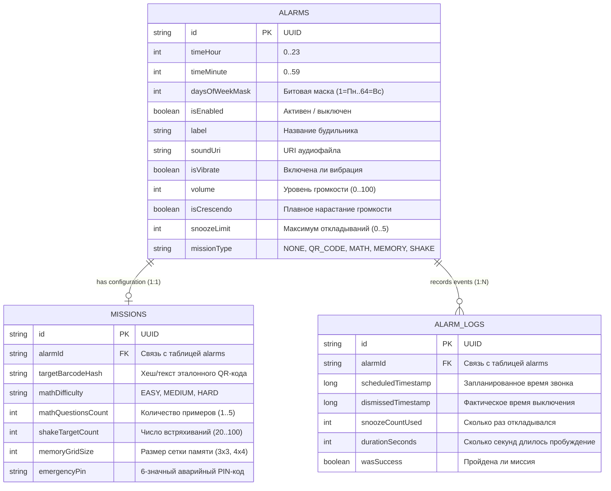
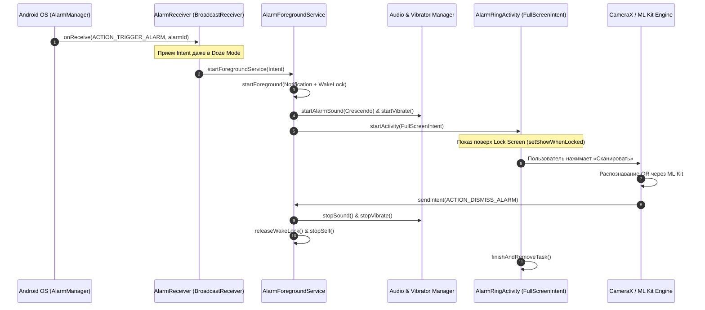

# Техническая спецификация SmartWake (SPEC)

> **Назначение документа**: Инженерная спецификация архитектуры, системных сервисов Android, базы данных, API и контрактов модулей. Является строгим руководством по реализации для разработчика.

---

## 1. Технологический стек и зависимости

| Компонент | Выбранная технология / Библиотека | Обоснование |
| :--- | :--- | :--- |
| **Язык разработки** | Kotlin 2.0+ (Coroutines + StateFlow) | Стандарт современной Android-разработки |
| **UI Фреймворк** | Jetpack Compose + Material 3 | Декларативный UI, реактивный стейт, отсутствие XML |
| **Архитектура** | Clean Architecture + MVVM / MVI | Однонаправленный поток данных (UDF), четкое разделение слоев |
| **База данных** | Room ORM (SQLite) + Kotlin Flow | Потокобезопасная реактивная персистентность данных |
| **Планировщик** | `AlarmManager.setAlarmClock()` | Единственный API Android, гарантирующий 100% запуск из Doze Mode |
| **Фоновые службы** | Foreground Service + WakeLock | Непрерывный звук, виброотклик и удержание процессора активным |
| **Полноэкранный показ**| Notification with `FullScreenIntent` | Отображение UI поверх экрана блокировки (Keyguard/Lock Screen) |
| **Компьютерное зрение**| CameraX + Google ML Kit Barcode Scanning | Локальное офлайн-распознавание всех форматов QR и 1D штрихкодов |
| **Сенсоры** | `SensorManager` (`TYPE_ACCELEROMETER`) | Детекция физических встряхиваний для Shake-капчи |
| **Аудио-движок** | `MediaPlayer` / `SoundPool` (`AudioAttributes.USAGE_ALARM`) | Проигрывание мелодии с перехватом аудиофокуса и системного канала |

---

## 2. Системные разрешения Android (AndroidManifest.xml)

```xml
<!-- Точные будильники (Android 12+) -->
<uses-permission android:name="android.permission.SCHEDULE_EXACT_ALARM" />
<uses-permission android:name="android.permission.USE_EXACT_ALARM" />

<!-- Полноэкранный интент поверх экрана блокировки (Android 14+) -->
<uses-permission android:name="android.permission.USE_FULL_SCREEN_INTENT" />

<!-- Фоновые службы и пробуждение процессора -->
<uses-permission android:name="android.permission.FOREGROUND_SERVICE" />
<uses-permission android:name="android.permission.FOREGROUND_SERVICE_SPECIAL_USE" />
<uses-permission android:name="android.permission.WAKE_LOCK" />

<!-- Уведомления и автозапуск при перезагрузке -->
<uses-permission android:name="android.permission.POST_NOTIFICATIONS" />
<uses-permission android:name="android.permission.RECEIVE_BOOT_COMPLETED" />

<!-- Аппаратные модули: Камера, Фонарик, Виброотклик -->
<uses-permission android:name="android.permission.CAMERA" />
<uses-feature android:name="android.hardware.camera" android:required="false" />
<uses-permission android:name="android.permission.VIBRATE" />

<!-- Исключение из жесткой оптимизации батареи -->
<uses-permission android:name="android.permission.REQUEST_IGNORE_BATTERY_OPTIMIZATIONS" />
```

---

## 3. Схема базы данных Room (ER-модель)



---

## 4. Жизненный цикл срабатывания будильника (Android Alarm Pipeline)



---

## 5. Доменные модели и State-машины

### Состояния экрана будильника (`AlarmRingState`):
```kotlin
sealed interface AlarmRingState {
    data class Ringing(
        val alarm: Alarm,
        val elapsedSeconds: Int,
        val snoozesRemaining: Int
    ) : AlarmRingState

    data class MissionActive(
        val alarm: Alarm,
        val mission: Mission,
        val currentStep: Int,
        val totalSteps: Int
    ) : AlarmRingState

    data class Dismissed(val durationSeconds: Int) : AlarmRingState
    data class Snoozed(val snoozeTimeMillis: Long) : AlarmRingState
    data object EmergencyUnlock : AlarmRingState
}
```

### Генератор математических капч (`MathGenerator`):
- **EASY**: Сложение и вычитание в пределах 100 (`A ± B`, где $10 \le A, B \le 90$).
- **MEDIUM**: Умножение двузначного числа на однозначное (`A * B`, где $12 \le A \le 40, 3 \le B \le 9$).
- **HARD**: Комбинированные выражения: `(A * B) ± C`.

---

## 6. Алгоритм сканирования QR (ML Kit ImageAnalysis)

1. Камера инициализируется через `CameraX.ProcessCameraProvider`.
2. Подключается анализатор кадров `ImageAnalysis` со стратегией `STRATEGY_KEEP_ONLY_LATEST`.
3. Кадр (в формате YUV/NV21) передается в `InputImage.fromMediaImage()`.
4. Экземпляр `BarcodeScanning.getClient()` в фоновом потоке выполняет поиск штрихкодов.
5. При обнаружении значения происходит сравнение с сохраненным `targetBarcodeHash`:
   - Если совпадает: вызов обратного вызова `onSuccess()` с немедленной вибрацией подтверждения.
   - Если не совпадает: кратковременный тактильный отклик об ошибке (Error Haptics) и сообщение в интерфейсе: «Не тот код! Ищите код в ванной».
6. Очистка ресурсов: закрытие камеры и остановка службы при завершении активности.
