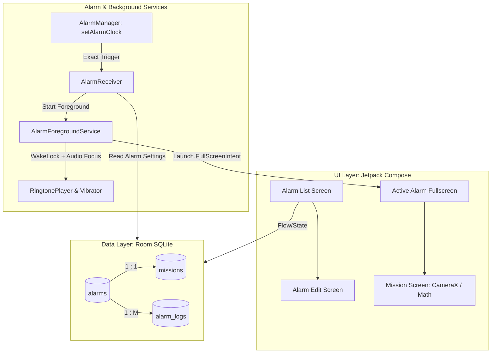

# Черновик и структура презентации проекта «SmartWake»

> **Формат**: Презентация подготовлена в строгом соответствии с эталонным стилем сдачи (референс: проект «PC Remote», отмеченный преподавателем).  
> **Каждый слайд содержит**: визуальную структуру, текстовые блоки, сравнительные таблицы/диаграммы и готовый текст для устного доклада (`### Notes:`).

---

## Слайд 1. Титульный слайд

* **Заголовок**: SmartWake: Умный будильник с QR-верификацией и мини-играми
* **Подзаголовок**: Мобильное Android-приложение для гарантированного пробуждения и борьбы с «утренним автопилотом».
* **Автор**: Салихов Эдуард, студент группы ПДО-XX
* **Технологический стек**: Android · Kotlin · Jetpack Compose / CameraX / Room DB
* **Статус**: Автономное офлайн-решение

### Notes:
> Здравствуйте, уважаемая комиссия! Тема моего проекта — «SmartWake: умный будильник с QR-капчей и когнитивными мини-играми». Наше приложение решает фундаментальную проблему просыпания будильников, полностью исключая возможность отключить сигнал на автомате в полусне.

---

## Слайд 2. Концепция проекта

* **Надзаголовок**: КОНЦЕПЦИЯ ПРОЕКТА
* **Главный тезис**: Цель — гарантированный подъем с кровати через физическое действие и включение логики.
* **Ключевые тезисы**:
  - **Бескомпромиссный подъем**: будильник нельзя заглушить обычным свайпом или нажатием кнопки громкости.
  - **Физическое перемещение**: чтобы отключить сигнал, необходимо встать с постели и отсканировать QR-код или штрих-код в ванной или на кухне.
  - **Когнитивная активация**: альтернативный режим — решение математических примеров или прохождение теста на память для включения префронтальной коры.
  - **100% приватность и офлайн**: никакой слежки, микрофонов или облачных подписок — все работает строго локально на устройстве без интернета.

### Notes:
> Главная идея SmartWake — превратить процесс пробуждения из пассивного раздражителя в четкий алгоритм. Стандартный будильник легко выключить, даже не открывая глаз. В SmartWake сигнал не прекратится, пока человек физически не дойдет до ванной комнаты для сканирования кода либо не активирует мозг решением задач.

---

## Слайд 3. Предпосылки и боли

* **Надзаголовок**: ПРЕДПОСЫЛКИ И БОЛИ
* **Заголовок**: Проблема, которую мы решаем

| Боль | В чем проявляется | Последствия |
| :--- | :--- | :--- |
| **Утренний автопилот** | Смахивание будильника «на автомате» в фазе полудремы без полного включения сознания. | Опоздания на работу, пары, важные встречи и самобичевание. |
| **Синдром сонной инерции** | Мозг выключает будильник и тут же «проваливается» в сон еще на 30–60 минут. | Хронический стресс от спешки и сбитый циркадный ритм. |
| **Коммерциализация аналогов** | Популярные аналоги (Alarmy) стали перегружены агрессивной рекламой и подписками по $40/год. | Раздражение пользователей и ненадежность из-за рекламных всплывающих окон. |

* **Итог слайда**: SmartWake возвращает надежный, чистый инструмент, который принудительно выводит пользователя из сонной инерции без рекламы и абонентской платы.

### Notes:
> В сомнологии описан феномен «сонной инерции»: в первые минуты после звонка когнитивные функции заторможены. Человек на рефлексах свайпает экран и засыпает дальше. Существующие решения в маркете либо требуют дорогую ежемесячную подписку, либо показывают видеорекламу прямо поверх воющего будильника, что неприемлемо. Мы решаем эту боль легковесным и надежным инструментом.

---

## Слайд 4. Анализ рынка и конкурентов

* **Надзаголовок**: АНАЛИЗ РЫНКА
* **Заголовок**: Почему SmartWake эффективнее и честнее аналогов

| Критерий | SmartWake (Наш проект) | Alarmy | I Can't Wake Up! | Системный будильник |
| :--- | :--- | :--- | :--- | :--- |
| **Физический QR/штрих-код** | **Да (любой бытовой код)** | Да (платный премиум) | Да | Нет |
| **Математические задачи** | **Да (настраиваемая сложность)** | Да | Да | Нет |
| **Работа 100% без интернета** | **Да (полная автономность)** | Требует сеть для аналитики | Да | Да |
| **Реклама и подписки** | **Полностью отсутствуют** | Назойливая реклама / 399 ₽/мес | Баннеры и реклама | Нет |
| **Защита от хитростей** | **Перехват кнопок + Safe-Exit** | Да | Частично | Нет |
| **Размер приложения** | **< 15 МБ** | > 80 МБ | ~25 МБ | Вшито в систему |

* **Объективная оценка**:
  - *В чем конкуренты сильнее*: у Alarmy есть распознавание звука шагов и распознавание объектов через облачные нейросети (фото раковины).
  - *В чем преимущество SmartWake*: полное отсутствие рекламы, моментальный старт, нулевой сетевой трафик, безопасность личных данных и прозрачный открытый код.

### Notes:
> Давайте сравним наше решение с лидерами рынка. Alarmy — флагман, но сегодня он перегружен рекламой и требует платную подписку за базовые функции сканирования кодов. Системный будильник не спасает от просыпания. SmartWake дает ключевую функциональность Alarmy — сканирование QR и математику — но делает это бесплатно, без рекламы и с гарантией офлайн-работы.

---

## Слайд 5. Системный дизайн и архитектура

* **Надзаголовок**: СИСТЕМНЫЙ ДИЗАЙН
* **Заголовок**: Архитектура и надежность срабатывания в Android

### Схема компонентов (Mermaid):


* **Архитектурные звенья**:
  1. **UI Layer**: Jetpack Compose — декларативный, отзывчивый интерфейс с поддержкой Material 3.
  2. **Android Alarm Core**: `AlarmManager.setAlarmClock()` гарантирует пробуждение устройства из Doze Mode даже в глубоком сне. `FullScreenIntent` выводит экран тревоги поверх блокировки экрана.
  3. **Vision & Captcha Engine**: `CameraX` + `Google ML Kit Barcode Scanning` для моментального локального распознавания штрих-кодов без задержек.
  4. **Data Layer**: Локальная база данных `Room (SQLite)` для хранения будильников, миссий и логов.

### Notes:
> Архитектура приложения спроектирована под жесткие ограничения Android 13-15. Главная проблема разработчиков будильников — когда ОС убивает процесс ради экономии батареи (Doze Mode). Мы используем системный вызов `setAlarmClock`, WakeLock и высокоприоритетный `Foreground Service`. Это гарантирует 100% срабатывание сигнала при любых энергосберегающих режимах.

---

## Слайд 6. Сценарий работы (User Flow)

* **Надзаголовок**: СЦЕНАРИЙ РАБОТЫ
* **Заголовок**: Пошаговый сценарий: от настройки до пробуждения

```
[01. Вечерняя настройка] ────> [02. Утренний аларм] ────> [03. Выполнение миссии] ────> [04. Пробуждение]
Привязка QR в ванной        Гарантированный сигнал      Сканирование QR-кода        Сигнал остановлен
или выбор уровня             поверх экрана блокировки    или решение математики      Осознанный подъем!
сложности математики         с нарастанием звука         с контролем валидности
```

* **Этапы выполнения**:
  - **Шаг 1. Первоначальная привязка**: Пользователь сканирует любой домашний QR/штрих-код (кофеварка, зубная паста) или выбирает сложность математики.
  - **Шаг 2. Срабатывание**: В назначенное время срабатывает звуковой сигнал и виброотклик. Экран загорается на полную яркость поверх пин-кода.
  - **Шаг 3. Запрет свайпа**: На экране отсутствует кнопка «Выключить». Доступна только кнопка «Начать миссию» (или «Отложить» с обратным отсчетом).
  - **Шаг 4. Успех**: При успешном распознавании QR-кода воспроизведение звука останавливается, фиксируется лог пробуждения.

### Notes:
> Сценарий пользователя максимально прозрачен: с вечера настраивается время и выбирается проверочный код. Утром раздается сигнал. На экране нет стандартного крестика или свайпа — пользователю нужно встать, дойти до источника кода, поднести камеру и подтвердить пробуждение. После этого будильник замолкает, а сонная дремота уже преодолена.

---

## Слайд 7. Возможности приложения

* **Надзаголовок**: ВОЗМОЖНОСТИ ПРИЛОЖЕНИЯ
* **Заголовок** Что умеет SmartWake

| Фича | Описание |
| :--- | :--- |
| 📷 **QR / Barcode Капча** | Распознавание любых стандартов: QR, EAN-13, UPC. Включение фонарика прямо в видоискателе камеры. |
| 🧮 **Математический тренажер** | 3 уровня сложности (от простых сложений до выражений в скобках с умножением). От 1 до 5 задач подряд. |
| 🧠 **Memory Puzzle** | Мини-игра на запоминание последовательности плиток для концентрации внимания. |
| 📳 **Shake-to-Wake** | Физическое встряхивание устройства (от 30 до 100 раз) через датчик акселерометра. |
| 🔊 **Нарастающая громкость** | Плавное пробуждение без стресса: нарастание звука от 0 до 100% за 30 секунд. |
| 🛡️ **Защита от обмана** | Блокировка регулировки системной громкости в момент срабатывания будильника. |

### Notes:
> SmartWake предлагает 4 независимых режима капчи. QR-код заставляет встать с кровати, математика заставляет мозг считать, тест памяти включает фокус, а режим встряхивания разгоняет пульс через легкую физическую нагрузку. Пользователь сам выбирает подходящий для себя уровень строгости.

---

## Слайд 8. Демонстрация интерфейса (План UI скриншотов)

* **Надзаголовок**: ДЕМОНСТРАЦИЯ ИНТЕРФЕЙСА
* **Заголовок**: Скриншоты рабочей версии приложения

*(На слайде размещается сетка из 4 скриншотов, аналогично слайду 9 в референсе Ларичева)*:

1. **[Кадр 1] Главный экран (Список будильников)**
   - Крупные карточки будильников со статусом переключателя (Switch ON/OFF).
   - Информационная плашка: «Будильник сработает через 7 ч 25 мин».
   - Иконка активной капчи (значок QR или калькулятора).
   - Кнопка Floating Action Button (+) для создания нового аларма.
2. **[Кадр 2] Экран настройки параметров**
   - Удобный круговой/барабанный пикер времени в стиле Material 3.
   - Чипы выбора дней недели (Пн, Вт, Ср, Чт, Пт).
   - Секция выбора миссии: выпадающий список `[QR-код | Математика | Встряхивание]`.
3. **[Кадр 3] Экран активного будильника (Lock Screen)**
   - Полноэкранный контрастный фон с текущим временем крупным шрифтом.
   - Мигающий индикатор и пульсирующая кнопка «НАЧАТЬ МИССИЮ».
   - Маленькая кнопка «Отложить на 5 мин» (с бейджем оставшихся попыток: «Осталась 1 попытка»).
4. **[Кадр 4] Экран выполнения миссии**
   - Видоискатель CameraX с зеленой рамкой наведения на QR-код / математический экран с крупными цифровыми кнопками.

### Notes:
> На слайде продемонстрирован интерфейс в соответствии с Material Design 3. Экран срабатывания максимально контрастен и понятен даже спросонья: крупные шрифты, отсутствие лишних элементов и четкая кнопка перехода к задаче.

---

## Слайд 9. Отказоустойчивость и безопасность

* **Надзаголовок**: БЕЗОПАСНОСТЬ И ОТКАЗОУСТОЙЧИВОСТЬ
* **Заголовок**: Системная надежность в экосистеме Android

* **Автозапуск при перезагрузке (`BOOT_COMPLETED`)**:
  - Даже если телефон разрядился или перезагрузился ночью, системный BroadcastReceiver восстанавливает очередь будильников из базы Room.
* **Изоляция Doze Mode**:
  - Запрос исключения из жесткой оптимизации батареи (`REQUEST_IGNORE_BATTERY_OPTIMIZATIONS`) предотвращает засыпание системного планировщика.
* **Механизм «Safe-Exit» (Защита от потери кода)**:
  - Что если QR-код смыло водой или потерялся? Предусмотрен аварийный таймаут (5 минут непрерывного звонка) либо ввод заранее заданного 6-значного пин-кода безопасности, чтобы телефон не остался бесконечно звонить.
* **Локальная конфиденциальность**:
  - Камера используется только для сканирования штрих-кода прямо в буфере памяти. Никакие снимки или видео не сохраняются в галерею и не уходят во внешнюю сеть.

### Notes:
> В мобильной разработке будильник — один из самых технически сложных продуктов из-за жестких политик энергосбережения Google. Мы закрыли все уязвимые места: обработали перезагрузку устройства, настроили WakeLock и внедрили Safe-Exit на случай утери QR-кода.

---

## Слайд 10. Итоги проекта и GitHub

* **Надзаголовок**: ИТОГИ ПРОЕКТА
* **Заголовок**: Результаты разработки

* **Достигнутые результаты**:
  - Создано полноценное native Android-приложение для победы над утренней ленью.
  - Реализованы аппаратные модули: CameraX, акселерометр, аудиофокус, AlarmManager.
  - Приложение полностью независимо от облачных сервисов и функционирует офлайн.

* **Планы развития (Roadmap)**:
  - Интеграция с умным домом по MQTT/HTTP (включение света в комнате при звонке).
  - Модуль шагомера (требование пройти 50 шагов до отключения).
  - Голосовая капча (произнести заданную скороговорку).

* **Материалы для проверки**:
  - **Исходный код проекта**: `https://github.com/EduardSalikhov/SmartWake`
  - **Готовый скомпилированный файл**: `app-release.apk` размещен в корневой директории GitHub репозитория для мгновенной установки.

* **Спасибо за внимание! Готов ответить на вопросы комиссии.**

### Notes:
> Исходный код проекта, подробная инструкция по сборке и готовый скомпилированный релизный APK-файл уже загружены в корень репозитория на GitHub. Большое спасибо за внимание, готов ответить на вопросы!
